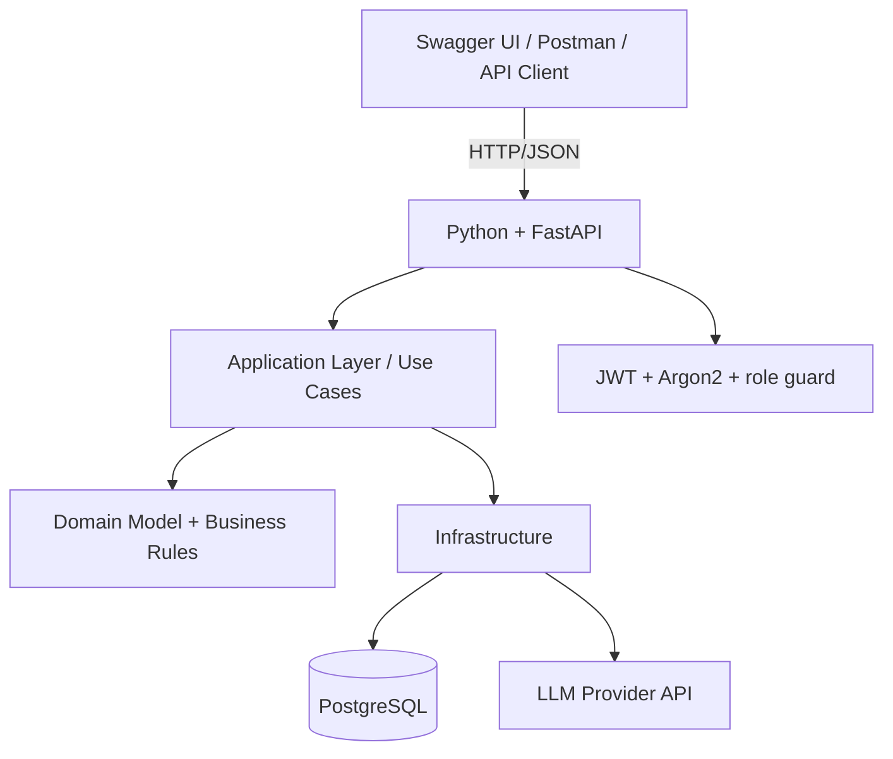

# CẤU TRÚC DỰ ÁN — HỆ THỐNG QUẢN LÝ KÝ TÚC XÁ

> Tài liệu kỹ thuật này có một số phần mô tả phạm vi cũ. Phạm vi và lịch 8 tuần
> hiện hành nằm trong `Master_Plan_MVP_8Tuan.xlsx` và `docs/05-ke-hoach-backend-only.md`.

> Đi kèm file `01-phan-tich-bai-toan-mvp.md` (chức năng và lộ trình). File này tập trung vào **kỹ thuật**: tech stack, kiến trúc, cấu trúc thư mục, database, API, môi trường chạy — đã **rút gọn** so với bản phân tích gốc để vừa sức làm trong 5 tuần.
>
> Phạm vi hiện hành chỉ có backend API. Không có frontend và không có import Excel.

---

## 1. Tech stack

| Thành phần | Lựa chọn | Lý do ngắn gọn |
|---|---|---|
| Backend | Python 3.12 + FastAPI | Type hints, OpenAPI tự động, phù hợp triển khai API nhanh |
| Database | PostgreSQL | Transaction mạnh, constraint tốt, JSONB cho snapshot tính tiền |
| Truy cập dữ liệu | SQL có tham số + SQLAlchemy Core + psycopg; Alembic migration | Không dùng ORM; nghiệp vụ chính gọi PostgreSQL function |
| Auth | JWT + pwdlib (Argon2) | Hash mật khẩu an toàn, phân quyền 3 role cố định |
| Chỉ số điện nước | Nhập thủ công qua API | Không có import Excel trong phạm vi 17 bảng |
| AI | `ILlmClient` → OpenAI API (hoặc provider tương đương) | Interface trừu tượng, dễ đổi provider sau này |
| Test | pytest + FastAPI TestClient | Unit test business rule + integration test luồng chính |
| Hạ tầng dev | Docker Compose (PostgreSQL) | Chạy local nhanh, đồng nhất giữa các máy trong nhóm |

**Không thêm ở MVP** (để không mất thời gian): MediatR, AutoMapper, Generic Repository/UnitOfWork riêng, Redis, message broker, microservices, vector database, Kubernetes, Serilog nâng cao, Testcontainers.

---

## 2. Kiến trúc tổng thể



Mô hình: **Modular Monolith** — một backend deploy duy nhất, một database, nhưng code chia module nghiệp vụ rõ ràng (Housing, Contracts, Utilities, Billing, Violations, Reports, AI). Đủ chuyên nghiệp, không tốn công triển khai microservices không cần thiết cho một đồ án 5 tuần.

Hướng phụ thuộc: `Api → Application → Domain`, và `Infrastructure` implement các interface do `Application` định nghĩa (không đi ngược chiều).

---

## 3. Cấu trúc dự án

```text
dormitory-management/
├── README.md
├── .gitignore
├── .env.example
├── docker-compose.yml
├── Master_Plan_MVP_8Tuan.xlsx
│
├── src/
│   └── backend/
│   │   ├── pyproject.toml
│   │   ├── alembic.ini
│   │   ├── dormitory_domain/
│   │   │   ├── housing/entities.py       # Building, Room, Bed, RoomType
│   │   │   ├── contracts/                # Application, Contract, BedAssignment
│   │   │   ├── utilities/                # Utility, Meter, MeterReading, Tariff, TariffTier
│   │   │   ├── billing/                  # Bill, BillItem, Payment, Receipt
│   │   │   ├── violations/               # ViolationType, Violation
│   │   │   └── common/enums.py           # enum dùng chung
│   │   │
│   │   ├── dormitory_application/
│   │   │   ├── identity/schemas.py
│   │   │   ├── housing/          # schemas, interfaces, service
│   │   │   ├── contracts/        # application workflows tuần 2
│   │   │   ├── utilities/        # công tơ, biểu giá, chỉ số thủ công
│   │   │   ├── billing/          # generate bill, payment, receipt
│   │   │   ├── violations/
│   │   │   ├── reports/          # OccupancyReport, RevenueReport
│   │   │   ├── ai/               # DraftPaymentReminder, SummarizeViolations
│   │   │   └── common/errors.py
│   │   │
│   │   ├── dormitory_infrastructure/
│   │   │   ├── persistence/      # database, models, repositories, migrations
│   │   │   ├── identity/         # JWT, Argon2, seed 3 role
│   │   │   └── ai/               # OpenAI client
│   │   │
│   │   └── dormitory_api/
│   │       ├── controllers/      # auth, housing
│   │       ├── middleware/       # exception handling -> errorCode
│   │       ├── authorization/    # dependency kiểm tra role
│   │       ├── dependencies.py
│   │       └── main.py
│
├── tests/
│   ├── unit/        # pytest business rules
│   └── integration/ # pytest luồng API chính
│
├── scripts/
│   ├── dev-up.sh
│   ├── migrate.sh
│   └── seed.sh
│
└── .github/workflows/ci.yml   # build + test, không cần pipeline phức tạp
```

> Lý do giữ **feature folders** trong Application: khi sửa module Utilities không phải lục khắp project; đúng với cách chia chức năng ở file phân tích (Mục 3).

---

## 4. Database — danh sách bảng (đã rút gọn cho MVP)

### 4.1. Nhóm Identity
- `AspNetUsers`, `AspNetRoles` (Identity mặc định) + `student_profiles` (student_code, ngày sinh, giới tính, khoa, khoá học).

### 4.2. Nhóm Housing Inventory
- `buildings` (code*, name, address, floors, status)
- `rooms` (building_id, code, capacity, monthly_rate, status) — unique `(building_id, code)`
- `beds` (room_id, code, status) — unique `(room_id, code)`

### 4.3. Nhóm Applications / Contracts
- `housing_applications` (student_id, term_code, requested_room_id, status, rejection_reason)
- `contracts` (contract_no*, student_id, start_date, end_date, status, base_rate, terminated_at)
- `bed_assignments` (contract_id, bed_id, start_date, end_date, status) — lưu giường đang được phân cho hợp đồng

### 4.4. Nhóm Utilities
- `utilities` (code: ELECTRICITY/WATER, unit)
- `meters` (room_id, utility_id, meter_code*)
- `meter_readings` (meter_id, period_start, period_end, previous_reading, current_reading, consumption) — unique `(meter_id, period_start, period_end)`, constraint `current_reading >= previous_reading`
- `utility_tariffs` (utility_id, effective_from, effective_to, pricing_mode)
- `tariff_tiers` (tariff_id, tier_order, from_quantity, to_quantity, unit_price)

### 4.5. Nhóm Billing
- `bills` (bill_no*, student_id, contract_id, period_start, period_end, subtotal, paid_amount, balance_due, status)
- `bill_items` (bill_id, type: HousingFee/Electricity/Water/ViolationFine/Adjustment, amount, calculation_snapshot_json)
- `payments` (payment_no*, bill_id, amount, method, paid_at) — cho phép nhiều payment/1 bill
- `receipts` (receipt_no*, payment_id* — unique, issued_at)

### 4.6. Nhóm Violations
- `violation_types` (code, name, default_severity, default_fine_amount)
- `violations` (student_id, contract_id, violation_type_id, occurred_at, severity, status, fine_amount)

*(dấu `*` = cột cần ràng buộc `unique`)*

### 4.7. Constraint bắt buộc kiểm tra kỹ trước khi nộp

```text
[ ] buildings.code unique
[ ] rooms(building_id, code) unique
[ ] beds(room_id, code) unique
[ ] contracts.contract_no unique
[ ] meter_readings(meter_id, period_start, period_end) unique
[ ] current_reading >= previous_reading
[ ] bills.bill_no unique
[ ] payments.payment_no unique
[ ] receipts.payment_id unique
[ ] payments.amount > 0
[ ] không có 2 bed_assignments trùng thời gian cho cùng 1 bed
```

---

## 5. API surface (rút gọn theo module — RESTful, JSON)

```http
# Auth
POST   /api/auth/login

# Housing inventory
GET    /api/buildings
POST   /api/buildings
GET    /api/rooms?buildingId=
POST   /api/rooms
GET    /api/beds?roomId=
POST   /api/beds

# Applications / Contracts
POST   /api/housing-applications            # sinh viên tạo
GET    /api/housing-applications?status=
POST   /api/housing-applications/{id}/approve
POST   /api/housing-applications/{id}/reject
POST   /api/contracts/{applicationId}/assign-bed
POST   /api/contracts/{id}/terminate

# Utilities
GET    /api/utility-tariffs
POST   /api/utility-tariffs
POST   /api/meter-readings                  # nhập tay

# Billing
POST   /api/bills/generate                  # phát hành hoá đơn theo kỳ
GET    /api/bills?studentId=&status=
GET    /api/bills/{id}
POST   /api/payments                        # ghi nhận thanh toán
GET    /api/receipts/{id}

# Violations
POST   /api/violations
POST   /api/violations/{id}/confirm
POST   /api/violations/{id}/reject
GET    /api/violations?studentId=

# Reports
GET    /api/reports/occupancy
GET    /api/reports/revenue

# AI (chỉ Admin/Staff)
POST   /api/ai/draft-payment-reminder
POST   /api/ai/summarize-violations/{studentId}
```

### Quy ước response lỗi (API client xử lý theo `errorCode`, không parse message)

```http
409 Conflict
{
  "errorCode": "BED_ASSIGNMENT_CONFLICT",
  "message": "Giường đã có người ở trong khoảng thời gian này."
}
```

Danh sách `errorCode` tối thiểu cần có: `BED_NOT_AVAILABLE`, `BED_ASSIGNMENT_CONFLICT`, `METER_READING_INVALID_SEQUENCE`, `BILL_ALREADY_EXISTS`, `PAYMENT_EXCEEDS_BALANCE`, `AI_PROVIDER_UNAVAILABLE`.

---

## 6. Cấu hình môi trường

### `.env.example`
```env
POSTGRES_DB=dormitory
POSTGRES_USER=dormitory
POSTGRES_PASSWORD=changeme
ConnectionStrings__Default=Host=localhost;Database=dormitory;Username=dormitory;Password=changeme

Llm__Provider=OpenAI
Llm__Model=<model-name>
OPENAI_API_KEY=<secret>   # chỉ cấu hình ở backend, không commit vào source
```

### `docker-compose.yml` (rút gọn)
```yaml
services:
  postgres:
    image: postgres:16
    environment:
      POSTGRES_DB: dormitory
      POSTGRES_USER: dormitory
      POSTGRES_PASSWORD: changeme
    ports: ["5432:5432"]
    volumes: ["pgdata:/var/lib/postgresql/data"]
volumes:
  pgdata:
```

Chạy local: `docker compose up -d` → `alembic upgrade head` → `uvicorn dormitory_api.main:app`.

---

## 7. Naming convention (ngắn gọn, để cả nhóm thống nhất từ đầu)

- **Python backend**: PascalCase cho class, snake_case cho hàm/biến/module, tên bảng số nhiều snake_case ở PostgreSQL (`bed_assignments`), cột snake_case.
- **API route**: kebab-case, số nhiều cho collection (`/housing-applications`).
- **Enum trạng thái**: PascalCase tiếng Anh trong code (`Approved`, `PartiallyPaid`), không hard-code chuỗi hiển thị trong logic nghiệp vụ.

---

## 8. Testing tối thiểu bắt buộc

| Loại | Bắt buộc? | Ghi chú |
|---|---|---|
| Unit test `BillingCalculator` (tính bậc giá) | **Bắt buộc** | Đây là logic dễ sai nhất và bị chấm kỹ nhất |
| Integration test luồng đăng ký → hợp đồng → hoá đơn | **Bắt buộc** | 1 test end-to-end là đủ, không cần bao phủ mọi nhánh |
| Unit test chống double-booking giường | **Bắt buộc** | Test 2 assignment chồng thời gian phải bị chặn |

---

## 9. Migration & Seed

- Mỗi thay đổi schema = 1 migration (`alembic revision --autogenerate -m ...`), không sửa migration đã chạy.
- Seed dữ liệu demo (`scripts/seed.sh`): 1 Admin, 2 Staff, 5–10 Student, 1 tòa với vài phòng/giường, 1 bảng giá điện/nước có 2–3 bậc — đủ để chạy hết checklist nghiệm thu ở file phân tích (Mục 7).
- Không hard-code mật khẩu admin production trong source; MVP đồ án có thể seed qua `appsettings.Development.json` nhưng cần ghi rõ trong README là "chỉ dùng cho môi trường phát triển".

---

## 10. Việc để lại sau MVP (ghi rõ để không quên, không phải để làm ngay)

```text
- room_transfer_requests dạng workflow 2 bước (sinh viên yêu cầu -> duyệt riêng)
- contract_amendments dạng log JSON đầy đủ lịch sử thay đổi hợp đồng
- Trạng thái "Appealed" (khiếu nại) cho vi phạm
- import_batches với thống kê chi tiết valid/invalid rows
- Audit log toàn hệ thống (hiện tại chỉ log hành động tài chính nhạy cảm)
- AI giải thích dashboard bằng ngôn ngữ tự nhiên (F28)
- Thanh toán online qua cổng ngân hàng, IoT đọc công tơ tự động, quản lý khách ra/vào
```
